# System diagrams

Models of the system as it is built, drawn from the code in `backend/app` and
`frontend/src`. They are written in Mermaid, so GitHub renders them and they can be
reviewed as text.

| # | Diagram | Question it answers | 4+1 view |
|---|---|---|---|
| 1 | [Context](#1-context-model) | What is inside the system, and what is around it? | – |
| 2 | [Use cases](#2-use-cases) | What can each actor do? | Scenarios |
| 3 | [Activity: upload](#3-activity-uploading-a-pdf) | What happens to a PDF, and when is it refused? | Process |
| 4 | [Activity: citation check](#4-activity-checking-a-citation) | How does a model answer become a verified one? | Process |
| 5 | [Class: backend](#5-class-diagram-backend) (2 parts) | Which objects carry the work? | Logical |
| 6 | [Class: stored data](#6-class-diagram-stored-data) | What survives a restart? | Logical |
| 7 | [Sequence: ask a question](#7-sequence-asking-a-question) | Who calls whom during a streamed answer? | Process |
| 8 | [Sequence: reopen a conversation](#8-sequence-reopening-a-conversation) | How do a document and its chat come back? | Process |
| 9 | [State: document](#9-state-machine-a-document) | What states does an uploaded document go through? | Process |
| 10 | [State: question](#10-state-machine-a-question) | How does the tool loop end? | Process |
| 11 | [Data flow](#11-data-flow-level-1) (3 parts) | Where does each piece of data go? | Logical |
| 12 | [Layered architecture](#12-layered-architecture) | How is the code organised? | Development |
| 13 | [Deployment](#13-deployment) | What runs where? | Physical |

## 1. Context model

PostgreSQL and Blob Storage count as neighbouring systems here because the case treats
them as external cloud services. Without their settings, the app keeps the same data in
process memory and in a local folder.

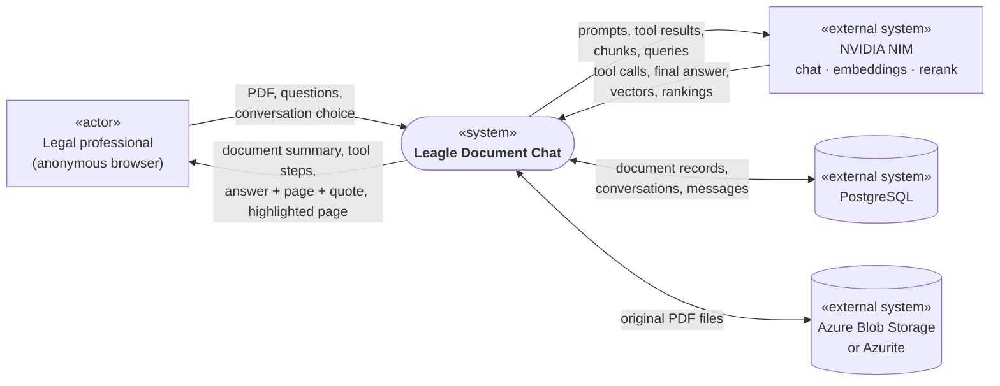

## 2. Use cases

Mermaid has no use case diagram, so this one is a flowchart: rounded nodes are use cases
and the box is the system boundary.

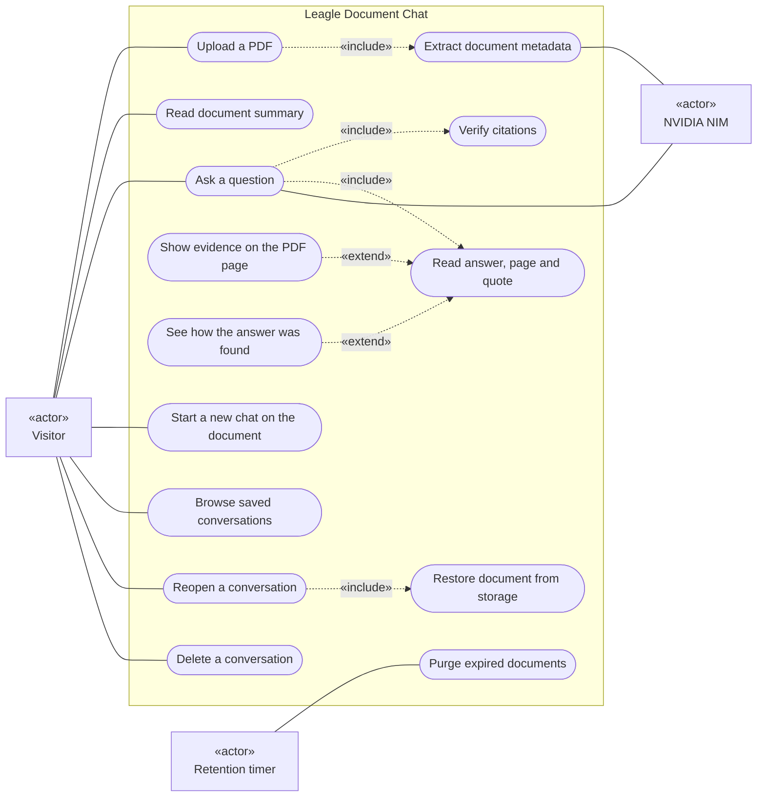

## 3. Activity: uploading a PDF

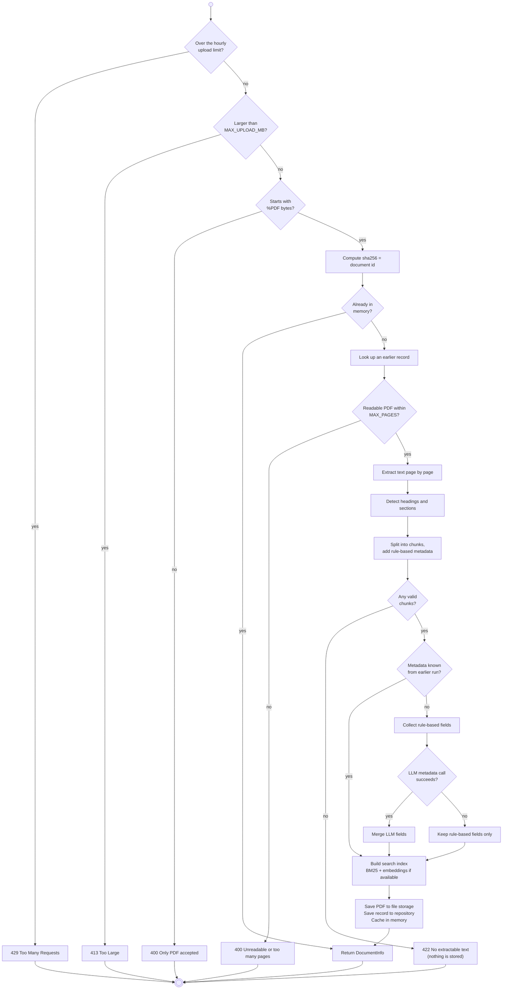

## 4. Activity: checking a citation

`grounding.verify()` runs on every answer before the user sees it. The model chooses the
wording; this code decides what counts as its source.

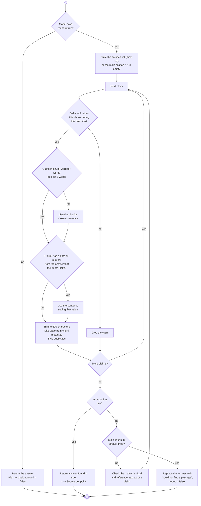

## 5. Class diagram: backend

Two parts, one for each main flow. `document_tools` and `grounding` are modules of
functions, not classes.

**Answering a question**

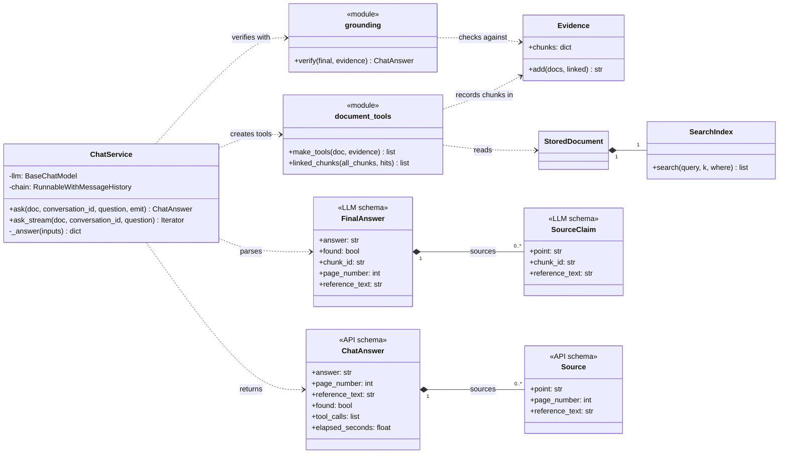

**Keeping documents and conversations**

`Repository` is a type alias of the two classes in the code. It is drawn as an interface
because both offer the same methods, and `ChatService` reads history through it.

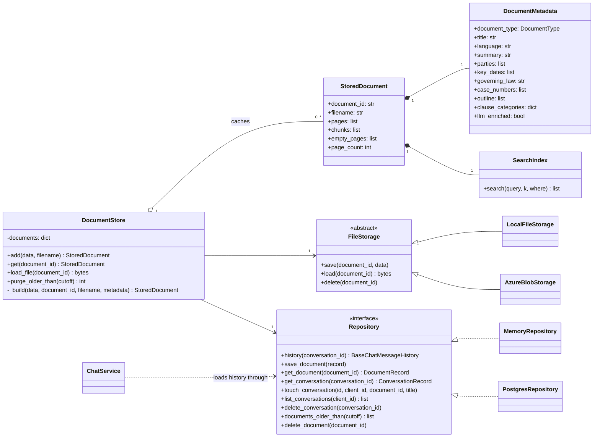

Pages, chunks and the search index are never stored. They are rebuilt from the PDF after a
restart, which is why [diagram 8](#8-sequence-reopening-a-conversation) needs Blob Storage.

## 6. Class diagram: stored data

Used when `DATABASE_URL` is set. `chat_history` is LangChain's own table and has no
database foreign key; its `session_id` holds the conversation id. A file in Blob Storage is
named `{documents.id}.pdf`.

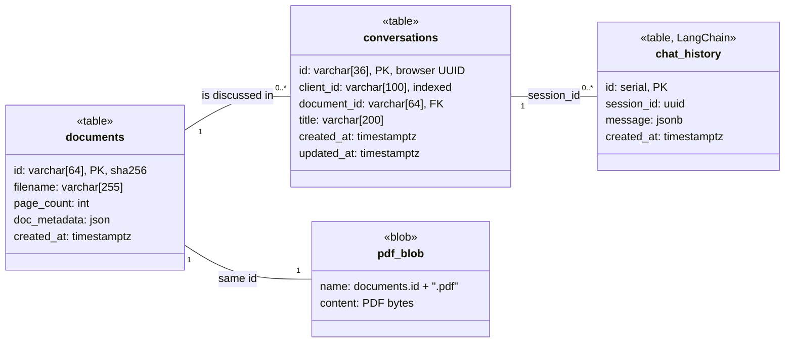

## 7. Sequence: asking a question

Requests reach the API through nginx in Docker; it is left out here for space. The chain
runs in a worker thread and passes events through a queue to the streaming response.

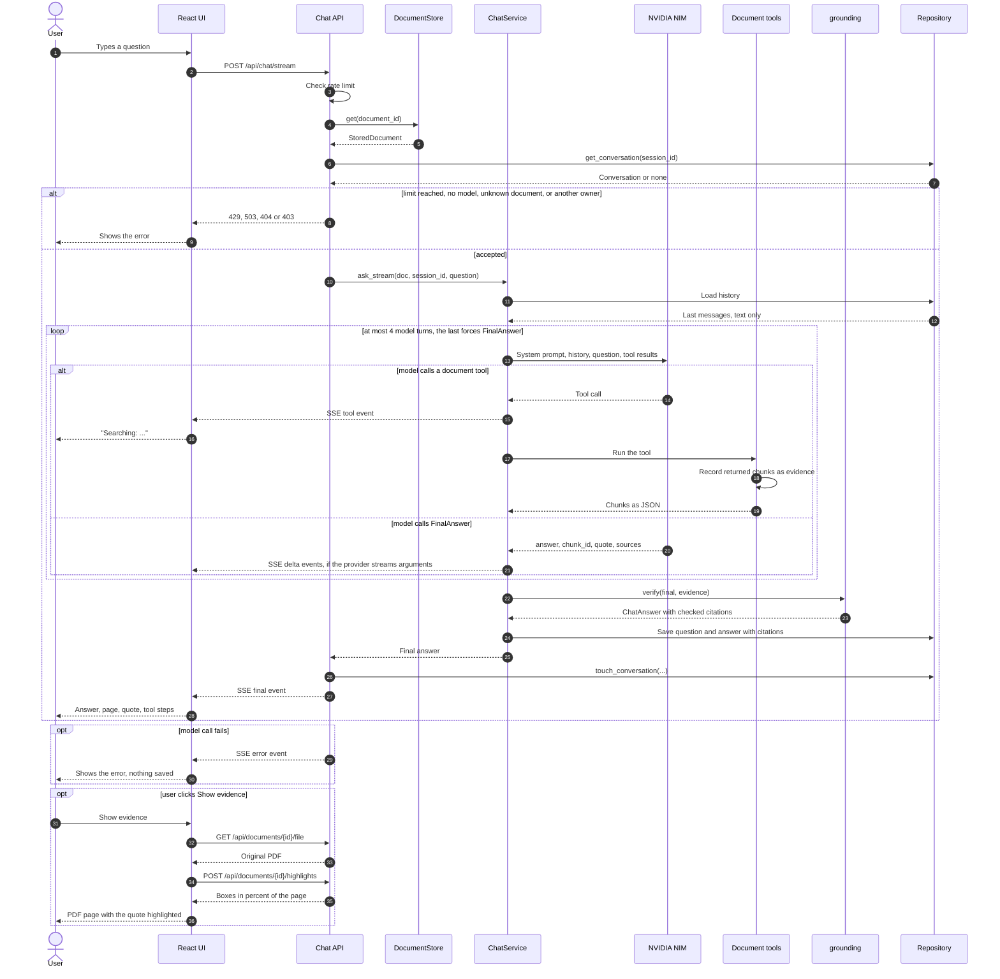

## 8. Sequence: reopening a conversation

This covers the cloud-backed bonus. After a restart the document is rebuilt without
another metadata call to the LLM. Embeddings are recomputed, because the index only lives
in memory.

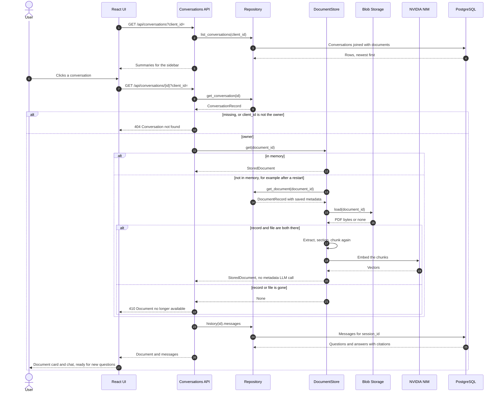

## 9. State machine: a document

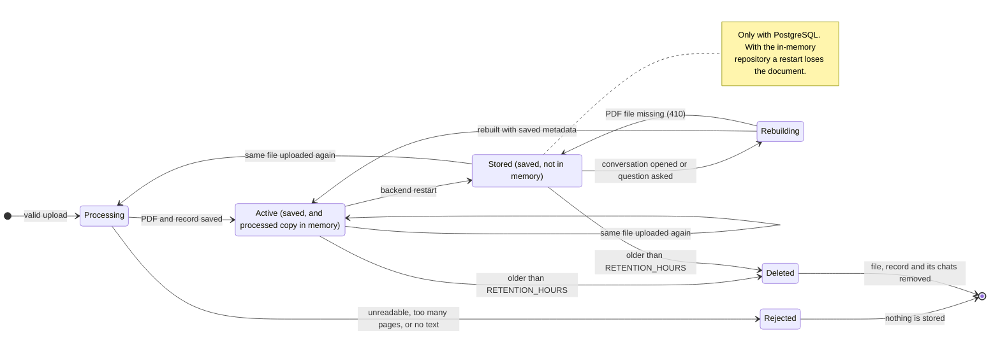

## 10. State machine: a question

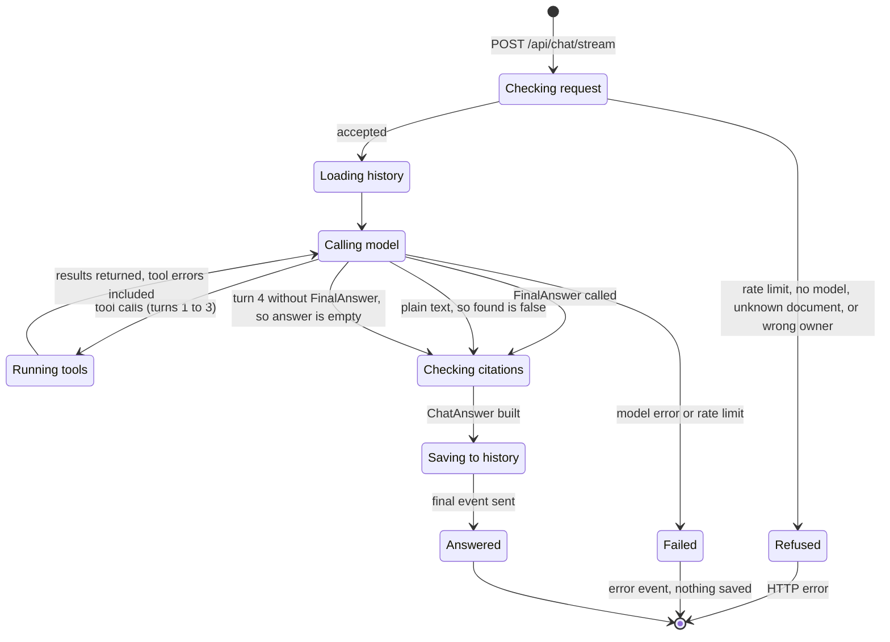

## 11. Data flow (level 1)

Circles are processes, cylinders are data stores and rectangles are external entities. The
level is split into three parts so that it stays readable; store numbers mean the same in
each part.

**Upload and retention**

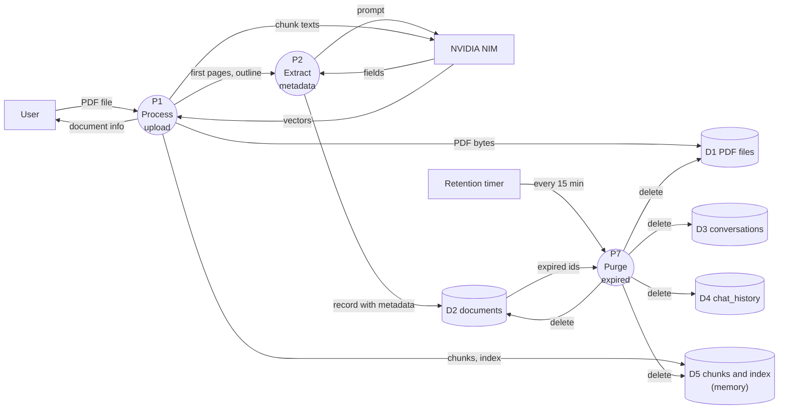

**Answering a question and showing evidence**

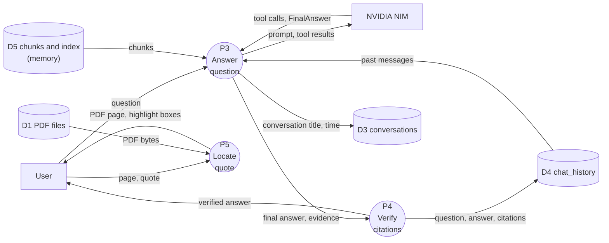

**Saved conversations**

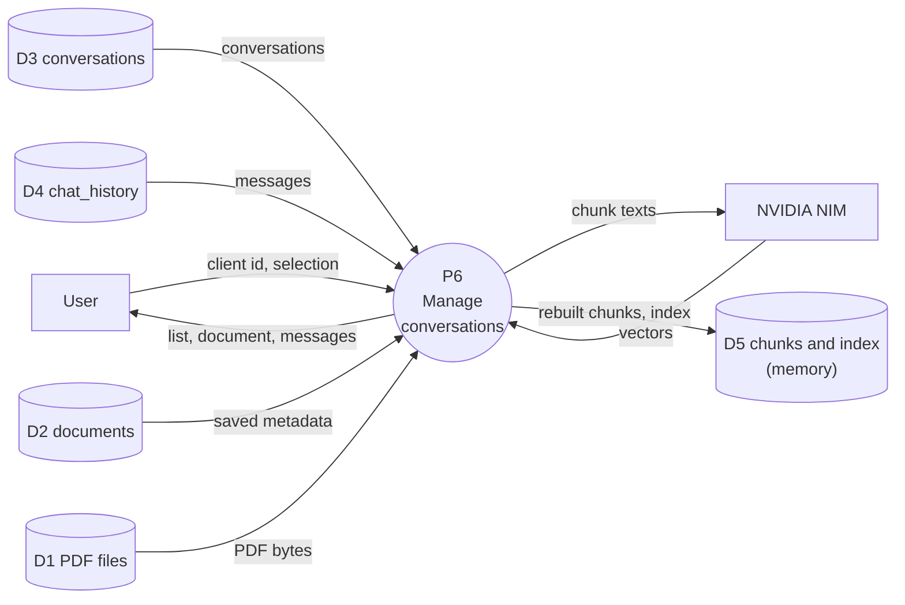

Document text leaves the system through P1, P2, P3 and P6. This is why the public demo asks
visitors not to upload confidential documents.

## 12. Layered architecture

The system combines three patterns:

- **Client-server:** the React UI talks to the backend only through `/api`.
- **Layered:** routers handle HTTP, services hold the logic, and adapters hold the
  external services.
- **Repository:** the same interfaces hide PostgreSQL or memory, and Blob or a local
  folder, so configuration alone picks the backend.

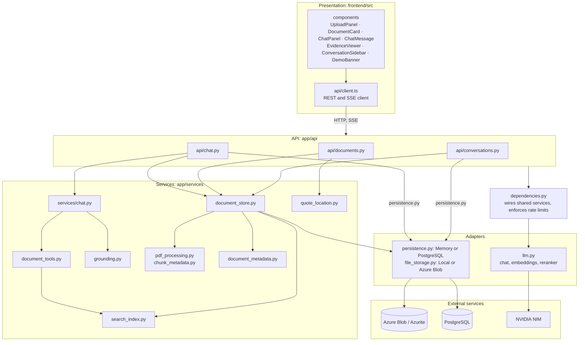

## 13. Deployment

This is the `docker-compose.yml` setup. The frontend container is the only entry point the
browser needs, and all published ports bind to `127.0.0.1`.

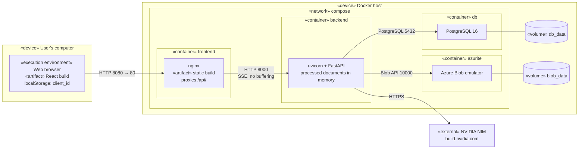
